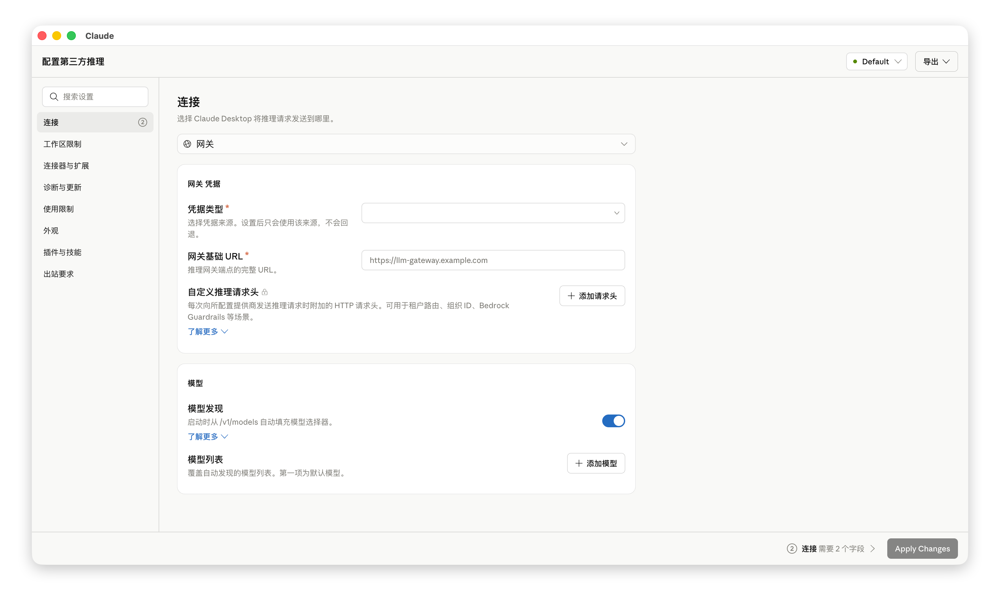
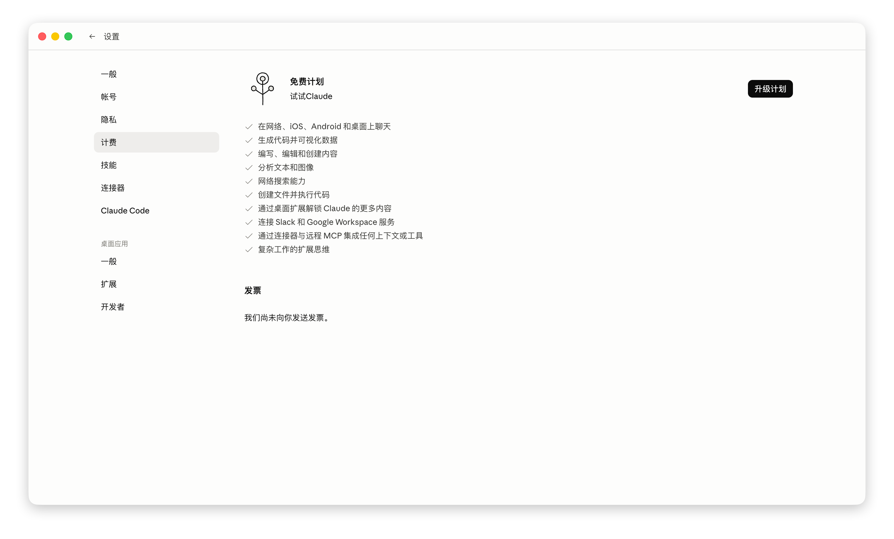

# Claude Desktop 中文补丁

一个用于 Claude Desktop 的本地中文界面补丁，支持简体中文、繁體中文（台灣）和繁體中文（香港）。

macOS 双击 `install-mac.command`；Windows 双击 `install-windows.bat` 后按 UAC 提示授权；Linux（官方 deb 包，或 Fedora 等发行版用社区脚本 [claude-desktop-rpm](https://github.com/ajithakdev/claude-desktop-rpm/) 安装）在终端运行 `./install-linux.sh`。脚本会给 Claude Desktop 添加中文语言选项并安装中文界面资源。

本项目支持官方账号和第三方 API，但不同安装模式覆盖的界面与 Cowork 兼容性不同，请先阅读下方的模式说明。第三方 API 配置可参考 [这篇教程](https://linux.do/t/topic/2032192)。

## 赞助商

<details open>
<summary>点击折叠</summary>
<table width="100%">
<tr>
<td width="250" align="center" valign="middle"><a href="https://tokenmetro.com"><picture><source media="(prefers-color-scheme: dark)" srcset="docs/images/tokenmetro-dark.png"></picture></a></td>
<td valign="middle"><strong>TokenMetro</strong> - 一家计费透明、自建号池的中转站。<br>
相对官方价格：GPT 1 折，Gemini 一次 5分，DeepSeek0.1折。<br>
明码标价，显示多少扣多少，不玩汇率魔术；自建号池，拒绝掺水。<br>
私信客服领取1r体验金，一键上车：<a href="https://tokenmetro.com">https://tokenmetro.com</a></td>
</tr>
<tr>
<td width="250" align="center" valign="middle"><a href="https://www.oxoapi.com"></a></td>
<td valign="middle"><strong>OXOAPI</strong> - 高质量国模自部署资源，AI 模型统一接口入口。热门国产模型 DeepSeek、Kimi、GLM 低至 4.5-6 折，海外模型低至 2.5 折；官网实时公开报价，价格自动刷新、通道状态透明可见；支持开具发票，企业采购更省心。注册即用：<a href="https://www.oxoapi.com">www.oxoapi.com</a>，完整价格表：<a href="https://www.oxoapi.com/pricing">www.oxoapi.com/pricing</a></td>
</tr>
<tr>
<td width="250" align="center" valign="middle"></td>
<td valign="middle"><strong>支持作者</strong> - 如果本项目对你有帮助，欢迎微信扫码赞赏支持作者！<br>
感谢每一份认可与鼓励，所有赞助都将用于本项目的持续维护、跟进新版本与测试设备支持。☕</td>
</tr>
</table>


</details>

<p align="center"><strong>遇到问题请及时反馈，欢迎扫码加入 claude desktop 交流。</strong></p>

<p align="center"></p>

## 界面截图

 

## 功能特点

- 一键安装 Claude Desktop 中文界面资源，支持 macOS、Windows 和 Linux（官方 deb 包，或面向 Fedora 等 RPM 发行版的 claude-desktop-rpm）。
- 支持三种中文变体：`zh-CN`（简体中文）、`zh-TW`（繁體中文（台灣））、`zh-HK`（繁體中文（香港））。
- 自动给 Claude 前端语言白名单加入当前选择的中文变体。
- macOS 和 Windows 只汉化第三方 API 模式的本地界面：Claude 官方账号登录页面已原生支持中文，这两个平台的脚本不再改动它。
- macOS 和 Windows 的本地斜杠菜单支持“英文命令名 + 中文说明”，兼容三种中文变体；命令 ID、搜索与点击行为保持不变。
- macOS 和 Linux 会合并当前 Claude 版本的英文语言文件与随包中文翻译；新版本新增但暂未翻译的字段保留英文，避免界面缺失文本。
- Windows 安装脚本会备份并修改当前 Claude Desktop 的资源文件，卸载时从备份恢复。Claude `4.29+` 的前端改为 `ion-dist.asar` 后，脚本会解包、重打包并同步 `Claude.exe` 中对应的 ASAR 头哈希；同时会就地改写 `app.asar`（保留 `unpacked`/`executable` 等元数据，不解包重打包），把桌面词库补进并合并进 `resources/i18n`，让主进程菜单栏也显示中文。两者都会使原有 Authenticode 签名失效。
- Linux 安装脚本会备份并重建安装目录下的 `ion-dist.asar`（Claude `4.29+`）或 `ion-dist` 目录，把中文词表合并进当前版本的英文词表并注册语言白名单；卸载时用备份按字节还原。备份存放在 XDG 状态目录，claude-desktop-rpm 的目录式升级不会连带删除；Claude Desktop 升级后会识别版本变化并重新备份。有官方中文壳层词表时，还会备份 `app.asar` 并为所选词表补齐仓库已有的缺失译文，无需重签名。
- macOS 安装前自动备份原始 `/Applications/Claude.app`。
- 自动写入 Claude 用户配置，将语言设置为所选中文变体。

## 适用环境

- macOS、Windows 或 Linux（官方 deb 包，或面向 Fedora 等 RPM 发行版的第三方脚本 claude-desktop-rpm）
- 已安装 Claude Desktop
- macOS 需要可用的 Python 3；脚本优先使用 `/usr/bin/python3`，不存在时从 `PATH` 查找 `python3`
- Windows 需要系统自带的 Windows PowerShell（`powershell.exe`）；批处理入口会自动请求管理员权限
- Linux 需要 Python 3 和 `flock`（util-linux），以 Claude Desktop 5.x 为基准（4.x 仍可安装中文前端，但菜单栏与官方账号页可能回落英文）。脚本会自动识别官方 deb 包（`/usr/lib/claude-desktop/resources`）与第三方脚本 claude-desktop-rpm（Fedora 等 RPM 发行版，将官方 deb 解包安装到 `~/.local/lib/claude-desktop`），也可用环境变量 `CLAUDE_RESOURCES` 直接指定资源目录、用 `CLAUDE_DESKTOP_PREFIX` 指定 claude-desktop-rpm 安装前缀。安装目录可写时不会调用 `sudo`，只有官方 deb 包等只读目录才需要。

## 使用方式

### macOS

1. 退出 Claude Desktop。
2. 下载或克隆本项目。
3. 双击 `install-mac.command`，选择操作：
   - `1` 安装中文补丁（第三方 API 模式）：安装中文资源、注册中文语言、汉化前端 bundle 与桌面壳层，并对应用做本机 ad-hoc 重签名。**不改写** `app.asar`；官方账号登录界面请直接使用 Claude 自带的语言设置。
   - `2` 恢复原样 / 卸载补丁。
   - `3` 自动更新设置：输入 `y` 禁止自动更新，输入 `n` 允许自动更新。
   - `4` CC Switch skills 同步：输入 `y` 同步，输入 `n` 删除之前的同步。
4. 选择安装后，脚本会先恢复已有旧备份以清理上一轮补丁；没有旧备份时会直接继续。
5. 选择语言：`1`=简体中文，`2`=繁體中文（台灣），`3`=繁體中文（香港）。
6. 按提示输入 Mac 登录密码（选项 `1`/`2`/`3`）。安装完成后 Claude 会自动重新打开。
7. 如果没有自动切换，打开左下角账号菜单，选择 `Language` -> 对应的中文选项。

CC Switch skills 同步会扫描 `~/.cc-switch/skills` 下包含 `SKILL.md` 的目录，只为 Claude Desktop 中不存在的同名 skill 创建软链接并更新 skills manifest。取消同步只删除由该目录同步出的软链接和对应记录，不删除 CC Switch 源目录。

### macOS 汉化后的自动更新

汉化会对应用做本机 ad-hoc 重签名。从 2026-08 版本起，重签时会显式写入 `identifier` 级别的 designated requirement（替代默认的 cdhash 级别），因此 Claude Desktop 的官方自动更新**下载后可以正常安装**，不会再卡在“下载完成但版本不变”。注意两点：

- 更新安装成功后，`/Applications/Claude.app` 会被官方英文版覆盖，重新运行本补丁即可恢复中文。
- 如果之前打过旧版补丁（默认 ad-hoc DR），需重新打一次补丁才会获得新签名行为。

### Windows

1. 退出 Claude Desktop。
2. 下载或克隆本项目。
3. 双击 `install-windows.bat`；脚本会复制安装文件到当前用户的临时目录，并弹出 UAC 管理员授权窗口。
4. 先选择操作：
   - `1` 安装中文补丁（第三方 API 模式，例如 DeepSeek）：安装中文资源、注册中文语言并汉化前端 bundle 与主进程菜单。脚本会在必要时就地改写 `app.asar` 补入桌面词库；Claude `4.29+` 会重建 `ion-dist.asar` 并更新 `Claude.exe` 中对应的完整性哈希，原有 Authenticode 签名会失效；同时脚本会自动修补 `cowork-svc.exe` 的客户端签名校验分支，彻底解决 Cowork 工作区因签名失效报 `RPC pipe closed` 的问题（卸载时自动恢复官方原包）。安装后 `English` 界面同样会显示中文（词库被合并覆盖进 `en-US`），切换语言无法回到纯英文，需要卸载或恢复备份才能还原。若 Claude 装在 `WindowsApps` 下且管理员拿不到写权限，脚本会接管该目录的所有权（所有者从 TrustedInstaller 改为 Administrators，卸载后不自动恢复，详见下文注意事项）。第三方模型需在网关或 CC Switch 中映射为 Claude/Anthropic 风格名称。
   - `2` 恢复原样 / 卸载补丁。
   - `3` 自动更新设置：输入 `y` 禁止自动更新，输入 `n` 允许自动更新。
   - `4` CC Switch skills 同步：输入 `y` 开启同步，输入 `n` 删除之前的同步。
5. 选择安装中文补丁时，脚本会先尝试从旧备份恢复来清理已有汉化；如果没有旧备份，会提示跳过并继续。
6. 选择语言：`1`=简体中文，`2`=繁體中文（台灣），`3`=繁體中文（香港）。
7. 脚本会备份被修改的文件、写入中文资源并重启 Claude Desktop。Claude `4.29+` 的 `ion-dist.asar` 会先解包到临时目录，完成汉化后再重打包并更新 `Claude.exe` 内的 ASAR 头哈希。如果没有自动切换，打开左下角账号菜单，选择 `Language` -> 对应的中文选项。

支持官网安装包（包括历史 Squirrel 版本与官网 MSIX 包）以及 Scoop（`scoop install extras/claude`）安装。安装器会自动识别当前系统安装的最新版本并跳过历史升级残留的旧版本目录。若安装在非标准自定义路径，可设置环境变量 `CLAUDE_PATH`（或通过参数 `-ClaudePath`）指定目录后运行脚本。

> **关于 Microsoft Store 商店版**：从微软应用商店（Microsoft Store）安装的包受 Windows 内核防篡改保护（Process Trust Label），系统强制禁止改写程序目录文件（管理员提权与接管所有权均无法绕过），因此**不支持直接对微软商店版打补丁**。请卸载商店版，并前往官网下载安装包（`ClaudeSetup.exe`）进行安装，即可正常使用本补丁。

### Linux（官方 deb 包 / Fedora 等 RPM 发行版）

Fedora 等 RPM 发行版可以用社区脚本 [claude-desktop-rpm](https://github.com/ajithakdev/claude-desktop-rpm/) 安装 Claude Desktop。Fedora Magazine 的《[Installing the official Claude Desktop Linux beta on Fedora Linux](https://fedoramagazine.org/installing-the-official-claude-desktop-linux-beta-on-fedora-linux/)》介绍了这个脚本的校验、更新和卸载方式。

1. 退出 Claude Desktop（脚本检测到正在运行时也会自动关闭）。建议在系统终端中运行，不要用 Claude Desktop 内嵌的终端，否则关闭应用会中断安装。
2. 下载或克隆本项目。
3. 在项目目录中打开终端，运行 `./install-linux.sh`，选择操作：
   - `1` 安装中文补丁：自动识别安装位置，备份原始前端，重建带中文词表的 `ion-dist.asar` 并注册中文语言。
   - `2` 恢复原样 / 卸载补丁。
4. 选择语言：`1`=简体中文，`2`=繁體中文（台灣），`3`=繁體中文（香港）。
5. 安装目录可写时直接完成，不会请求 `sudo` 密码；只有官方 deb 包等只读目录才会调用 `sudo`。完成后重新打开 Claude Desktop；如果没有自动切换，打开左下角账号菜单，选择 `Language` -> 对应的中文选项。

脚本会优先识别正在运行的 Claude Desktop 所在目录；未运行时先看 `CLAUDE_DESKTOP_PREFIX/lib/claude-desktop/resources`（默认 `$HOME/.local`），再看 `~/.local/lib/claude-desktop/resources` 与 `/usr/lib/claude-desktop/resources`。也可以用 `CLAUDE_RESOURCES` 直接指定 `resources` 目录。

官方账号登录界面由 Claude 原生提供中文，脚本会把 `locale` 设为 `zh-Hans` / `zh-Hant`；本地打包前端的汉化主要作用于第三方 API（3p）模式。

> Linux 以 Claude Desktop 5.x 为基准：5.x 的桌面壳层自带 `zh-Hans` / `zh-Hant` 词库。4.x 没有这两种壳层词库，脚本仍会安装中文前端，但菜单栏和官方账号页可能回落英文。

也可以跳过菜单直接调用：`./install-linux.sh install zh-CN`（可选 `zh-TW` / `zh-HK`）或 `./install-linux.sh uninstall`。

### Linux 升级后恢复

通过 apt 或 claude-desktop-rpm 升级 Claude Desktop 会替换安装目录，覆盖补丁，界面会变回英文。建议先更新本项目（克隆的用 `git pull`，下载压缩包的重新下载最新版本），再重新运行一次安装：

```bash
git pull
./install-linux.sh install zh-CN
```

原始前端备份保存在 `~/.local/state/claude-desktop-zh-cn/<版本>@<安装路径摘要>/`（遵循 `XDG_STATE_HOME`），不在应用目录内，因此 claude-desktop-rpm 的目录式升级不会连带删除；同机多份安装各自保留备份与 locale 原值。脚本会识别 Claude Desktop 的版本变化，自动丢弃同一安装的旧版本备份并重新备份，不会把旧版前端装回去；没有版本元数据时（例如 `CLAUDE_RESOURCES` 指向手工目录）用 `app.asar` 的摘要作为备份键，升级后同样会重新备份。若新版本改动了代码结构导致补丁没有生效，脚本会直接报错，请带上 Claude Desktop 版本号反馈。

## 文件说明

- `install-mac.command`：macOS 双击运行入口。
- `install-windows.bat`：Windows 安装 / 恢复菜单入口。
- `install-linux.sh`：Linux 安装 / 恢复菜单入口（自动识别 deb 包与 claude-desktop-rpm）。
- `scripts/install_windows.ps1`：Windows 汉化安装和卸载脚本。
- `scripts/install_linux.sh`：Linux 汉化安装和卸载脚本；识别安装位置、按需提权，备份保存在 XDG 状态目录。`install-linux.sh` 的菜单会调用它，也可直接带参数调用。
- `scripts/patch_linux_asar.py`：解包 `ion-dist.asar`（或复制 `ion-dist` 目录），把当前版本的英文词表与随包中文词表合并为 `zh-Hans` / `zh-Hant`，注册语言白名单后重新打包并校验结构。有官方中文壳层词表时，也会从原始 `app.asar` 生成壳层补丁。
- `scripts/patch_claude_zh_cn.py`：真正执行补丁的 Python 脚本。
- `resources/manifest.json` / `manifest-zh-TW.json` / `manifest-zh-HK.json`：语言包信息。
- `resources/frontend-zh-CN.json` / `frontend-zh-TW.json` / `frontend-zh-HK.json`：Claude 前端界面中文翻译。
- `resources/frontend-hardcoded-zh-CN.json` / `frontend-hardcoded-zh-TW.json` / `frontend-hardcoded-zh-HK.json`：未走 i18n key 的前端硬编码文本映射，也用于在线账号页面的 DOM 翻译表。
- `resources/desktop-zh-CN.json` / `desktop-zh-TW.json` / `desktop-zh-HK.json`：Claude 桌面壳层中文翻译。
- `resources/Localizable.strings` / `Localizable-zh-TW.strings` / `Localizable-zh-HK.strings`：macOS 原生菜单中文资源。
- `resources/statsig-zh-CN.json` / `statsig-zh-TW.json` / `statsig-zh-HK.json`：statsig i18n 兜底资源。
- `resources/release.json`：安装入口用于检查 GitHub Releases 是否有新版的版本信息。

## 斜杠菜单双语说明

macOS / Windows 安装时，会尝试给本地 `SlashCommandMenuPopupBody` 中的已知内置命令追加中文说明，例如 `model  选择模型`、`permissions  权限模式`。原英文名称与搜索高亮保留，点击后仍执行原命令；自定义技能、第三方插件命令、连接器和未知命令不强行翻译。

- `resources/slash-command-glosses.json`：简体、繁体台湾、繁体香港的说明词表。
- `resources/slash-command-menu-patch.json`：两平台共用的组件匹配规则、唯一锚点和显示层补丁。匹配局部变量而不是固定 bundle 文件名。
- 重复安装不重复追加；直接切换语言时只更新说明词表。Windows 在写入前沿用现有原文件备份机制，macOS 沿用整包备份和重签流程。
- 若组件缺失、锚点不唯一或已有补丁形态不符，会输出 `WARNING` 并保持该菜单文件不变，其他汉化步骤继续。应用升级后可能需要更新匹配规则，语法匹配不代表兼容所有未来版本。
- 此功能不注入在线账号页面，也未接入 Linux 的独立安装脚本。

## 开发与回归测试

测试只使用合成菜单和临时目录，不启动或修改已安装的 Claude，不需要管理员权限。运行需要 Python 3.10+、Node.js，以及用于检查 Windows 逻辑的 PowerShell 5.1 或 PowerShell 7：

```bash
python -I -m unittest discover -s tests -v
```

```bash
powershell -NoProfile -ExecutionPolicy Bypass -File tests/Test-StructuralReplacements.ps1
```

```bash
powershell -NoProfile -ExecutionPolicy Bypass -File tests/Test-SlashCommandMenu.ps1
```

```bash
powershell -NoProfile -ExecutionPolicy Bypass -File tests/Test-AsarFrontend.ps1
powershell -NoProfile -ExecutionPolicy Bypass -File tests/Test-AsarIntegrity.ps1
powershell -NoProfile -ExecutionPolicy Bypass -File tests/Test-AsarFrontendWorkflow.ps1
powershell -NoProfile -ExecutionPolicy Bypass -File tests/Test-WriteAccess.ps1
powershell -NoProfile -ExecutionPolicy Bypass -File tests/Test-ProcessStop.ps1
powershell -NoProfile -ExecutionPolicy Bypass -File tests/Test-AsarReplace.ps1
```

PowerShell 7 环境可将 `powershell` 替换为 `pwsh`。测试覆盖高风险词跳过、三地 i18n、Windows 真实 C# 快速路径与备用路径、菜单点击/高亮、语言切换、幂等、备份顺序、进程停止失败中止和 asar 锁文件预检。合成测试不能替代完整客户端的视觉验收。

如需对已安装 Claude 的实际 `ion-dist.asar` 做逐文件无损往返验证，可传入包路径：

```bash
powershell -NoProfile -ExecutionPolicy Bypass -File tests/Test-AsarRoundTrip.ps1 -ArchivePath "C:\Program Files\WindowsApps\Claude_4.29.0.0_x64__pzs8sxrjxfjjc\app\resources\ion-dist.asar"
```

## macOS 脚本会做什么

- 安装时备份当前 `/Applications/Claude.app` 到同目录，名字类似：
  `Claude.backup-before-zh-CN-20260424-120000.app`
- 安装前会先尝试恢复已有旧备份，清理上一轮汉化；没有旧备份时跳过并继续安装。
- 恢复 / 卸载时选择同目录下最早的 `Claude.backup-before-zh-CN-*.app` 恢复为 `/Applications/Claude.app`，并删除其他备份。
- 复制 Claude.app 到临时目录并打补丁。
- 给前端语言白名单加入当前选择的中文变体。
- 汉化前端 bundle 中未走 i18n key 的硬编码文本，并修正中文语言显示名称。
- 不修改 `Contents/Resources/app.asar`：在线账号界面由 Claude 原生提供中文，本项目不再注入 DOM 翻译、语言锁定或模型选择器补丁。
- Claude `4.29+` 的前端改为 `Contents/Resources/ion-dist.asar`：脚本会先备份原包，解包到临时 `ion-dist` 目录执行汉化，再按 ASAR 格式重打包并校验结构；重打包后同步 `Info.plist` 中 `ElectronAsarIntegrity` 的 `Resources/ion-dist.asar` 头哈希，避免应用因完整性校验失败无法加载前端。`4.29` 之前的目录布局保持原有逻辑。
- 合并当前 Claude 版本的 `en-US.json` 和随包中文翻译：
  当前版本已有中文翻译的 key 会变中文，新版本新增但本包没有的 key 会保留英文，避免应用缺字段。
- 写入 `~/Library/Application Support/Claude/config.json`，设置 `"locale"` 为所选语言代码（`zh-CN`、`zh-TW` 或 `zh-HK`）。
- 对修改后的 Claude.app 及其内部 app/framework/原生二进制做一致的本机 ad-hoc 重签名，并清除 `com.apple.quarantine` 隔离属性。
- 重新启动 Claude。
- 可选菜单项 `5` 用 `y/n` 控制 Claude Desktop 自动更新：`y` 禁止自动更新，`n` 允许自动更新。若当前存在有效的 Claude-3p `configLibrary`，脚本会写入当前 applied 配置；否则写入 Claude Desktop enterprise policy。
- 可选菜单项 `6` 用 `y/n` 控制 CC Switch skills 同步：`y` 会把 `~/.cc-switch/skills` 中缺失的 skill 软链接到 Claude Desktop 的本地 skills 目录，并更新对应 `manifest.json`；`n` 只删除之前同步产生的 CC Switch 软链接和对应 manifest 记录。该操作不需要管理员权限，不会覆盖同名 skill。

## Windows 脚本会做什么

- 查找 Windows 版 Claude Desktop 安装目录。
- 安装前会先尝试从 `resources\.zh-cn-backups` 恢复旧备份，清理上一轮汉化；没有旧备份时跳过并继续安装。
- 复制本仓库现有中文资源，不使用其他语言包项目里的 JSON：
  - `resources/frontend-zh-CN.json` / `frontend-zh-TW.json` / `frontend-zh-HK.json` -> `ion-dist\i18n\` 对应语言代码 `.json`
  - `resources/desktop-zh-CN.json` / `desktop-zh-TW.json` / `desktop-zh-HK.json` -> `resources\` 对应语言代码 `.json`，同时补进 `app.asar` 的 `resources/i18n\` 供主进程菜单读取
  - `resources/statsig-zh-CN.json` / `statsig-zh-TW.json` / `statsig-zh-HK.json` -> `ion-dist\i18n\statsig\` 对应语言代码 `.json`
- 给前端语言白名单加入当前选择的中文变体。
- 汉化前端 bundle 中未走 i18n JSON 的硬编码界面文本，例如侧边栏入口、配置页标签和模型选择项。
- Claude `4.29+` 的主进程菜单只读取 `app.asar` 内的 `resources/i18n` 词库：安装器会备份 `app.asar`，然后在原位改写头部（新内容追加到 payload 末尾，只更新对应条目的 `offset`/`size`/`integrity`），不解包重打包，因此 `unpacked`、`executable`、`link` 等元数据和 `.unpacked` 目录都不受影响。
- Claude `4.29+` 的新版前端位于 `ion-dist.asar`，安装器会先备份原包，再解包到临时 `ion-dist` 目录执行汉化；完成后按 ASAR 格式重打包、校验结构并替换原文件。
- 由于 Claude `4.29+` 的壳层和前端都固定按 `en-US` 加载词库（渲染进程约 1 秒后还会把 locale 写回 `en-US`），安装器会把所选中文词库合并覆盖进 `app.asar` 的 `resources/i18n/en-US.json` 与 `ion-dist.asar` 的 `i18n/en-US.json`，未翻译的键保留英文，从而覆盖只存在于词库、JS 里没有字面量的条目（例如模型档位描述）。副作用是 `English` 界面也会显示中文，且无法通过切换语言还原英文，卸载或恢复备份后才会恢复。
- 改写 `app.asar` 或重建 `ion-dist.asar` 后，安装器会同步 `Claude.exe` 内嵌的 `app.asar` 与 `ion-dist.asar` 头哈希。此时 `Claude.exe` 的原始 Authenticode 签名会失效；针对该失效导致的 Cowork 管道拦截问题，安装器会自动修补 `cowork-svc.exe`，将签名强制校验降级为告警，解决 Cowork 工作区报 `RPC pipe closed` 的问题；卸载时从备份恢复官方未修改的 `cowork-svc.exe`，签名自动恢复有效。
- Windows 上 Claude 安装在 `C:\Program Files\WindowsApps\<包名>\app`，该目录默认属于 `TrustedInstaller`，UAC 提权后的 `Administrators` 只有读和执行权限。安装器不再只看 ACL，而是先实测能否写入；不能时依次追加允许规则、清理阻止写入的显式拒绝规则（Windows 中 Deny 优先于 Allow），仍然不行才用 `takeown /a` + `icacls` 接管所有权。**接管会把该目录的所有者从 `TrustedInstaller` 改为 `Administrators`，并授予其完全控制；卸载不会自动恢复**，只有重装或升级 Claude 时由系统重置，部分安全软件或企业策略可能拦截或告警。交互模式下执行前会二次确认，输入 `n` 可跳过；非交互调用（脚本、自动化）**默认不接管**，必须显式加 `-AllowTakeOwnership` 或设置环境变量 `CLAUDE_ZH_ALLOW_TAKE_OWNERSHIP=1`。写入权限最终拿不到时安装会直接中止，而不是继续写 asar 留下「asar 已改、exe 哈希没写回」的半坏状态。
- 写 `app.asar` / `ion-dist.asar` 前，安装器会先确认 Claude Desktop 已完全退出，并独占探测目标文件是否可替换。如果应用在另一个 Windows 账户下运行、或文件被安全软件锁定，会**在改动任何文件前**提示“文件仍被占用”并中止，而不是写到一半才失败。遇到该提示时，请在任务管理器中结束所有 `Claude.exe` / `cowork-svc.exe`（或注销另一个账户）后重试。
- 写入 Windows 用户配置，将语言设置为所选语言代码（`zh-CN`、`zh-TW` 或 `zh-HK`）。
- 可选菜单项 `3` 用 `y/n` 控制 Claude Desktop 自动更新：`y` 禁止自动更新，`n` 允许自动更新。若当前存在有效的 Claude-3p `configLibrary`，脚本会写入当前 applied 配置；否则写入 `HKCU\SOFTWARE\Policies\Claude` policy。
- 可选菜单项 `4` 用 `y/n` 控制 CC Switch skills 同步：`y` 会把 `%USERPROFILE%\.cc-switch\skills` 中缺失的 skill 以软链接加入 Claude Desktop 的本地 skills 目录，并把 `SKILL.md` frontmatter 里的 `name` 和 `description` 写入对应 `manifest.json`；`n` 只删除之前同步产生、且指向 CC Switch skills 目录内的软链接和对应 manifest 记录。脚本会从当前用户的 AppData 动态扫描 Claude-3p skills plugin，不写死 session UUID，不覆盖同名 skill，也不删除 CC Switch 源目录。
- 重启 Claude Desktop。

## Linux 脚本会做什么

- 自动查找安装位置：优先 `CLAUDE_RESOURCES`，其次是正在运行的 Claude Desktop 所在目录、`CLAUDE_DESKTOP_PREFIX/lib/claude-desktop/resources`（默认 `$HOME/.local`）、`~/.local/lib/claude-desktop/resources`、`/usr/lib/claude-desktop/resources`，并关闭该安装目录下正在运行的 Claude Desktop 进程。安装目录可写时不需要 `sudo`，只有只读目录（例如官方 deb 包）才会在写入时调用 `sudo`。
- 读取 Claude Desktop 版本号：优先使用 claude-desktop-rpm 写入的 `.deb-version`，其次查询 `dpkg-query`。
- 把原始前端备份到 `$XDG_STATE_HOME/claude-desktop-zh-cn/<版本>@<安装路径摘要>/`（默认 `~/.local/state/claude-desktop-zh-cn/`），不放在应用目录内；locale 原值按安装单独记录，重复安装不会覆盖，升级后仍能还原。应用升级后会丢弃同一安装的旧版本备份并从新文件重新备份；每次安装都基于原始备份重新生成，可重复运行。
- 合并当前 Claude 版本的英文语言文件与随包中文翻译（当前版本已有中文翻译的 key 会变中文，新版本新增但本包没有的 key 保留英文），写入前端包：
  - `resources/frontend-zh-CN.json` / `frontend-zh-TW.json` / `frontend-zh-HK.json` -> `i18n/zh-Hans.json` 或 `i18n/zh-Hant.json`（以及 `.overrides.json`）
  - `resources/dynamic-*.json` -> `i18n/dynamic/zh-Hans.json` / `zh-Hant.json`
  - `resources/statsig-*.json` -> `i18n/statsig/zh-Hans.json` / `zh-Hant.json`
- 解包 `ion-dist.asar`，给语言白名单加入 `zh-Hans` / `zh-Hant`，用 `frontend-hardcoded-*.json` 汉化前端 bundle 中未走词表的界面文本，再重新打包。更早版本的 `ion-dist` 目录布局则在副本上修改。打完补丁后会校验词表和语言白名单确实写入，结构不符时报错退出。
- Claude 5.x 的桌面壳层从 `app.asar` 读取官方 `zh-Hans` / `zh-Hant`。Linux 会备份原始归档，用 `desktop-*.json` 补齐所选中文词表缺失且在当前英文词表中存在的条目。已有官方译文、英文词表及其他归档条目均保留。旧版本没有对应的官方中文词表时，只安装前端补丁。
- 壳层原包和补丁包的 SHA-256 保存在同一 XDG 状态根目录的 `desktop@<安装路径摘要>.json`。新补丁只更新目标 ASAR 条目，归档头无需额外的状态字段。旧补丁的内嵌摘要仍可用于匹配原始备份，重装补丁时会迁移到外部记录。安装和卸载请使用同一个 `XDG_STATE_HOME`，并保留其中的状态文件与备份。
- 写入 `~/.config/Claude/config.json` 与 `~/.config/Claude-3p/config.json`（文件存在时）的 `"locale"`，值为 `zh-Hans` 或 `zh-Hant`，并记录修改前的值。
- 恢复 / 卸载时从同版本原始备份按字节还原 `ion-dist.asar`（或 `ion-dist` 目录）和已补丁的 `app.asar`，恢复用户 locale 原值并清理备份。若检测到补丁却缺少匹配的原始备份，会提示用 apt 或 claude-desktop-rpm 重装 Claude Desktop。

## 卸载 / 恢复

执行对应平台的安装入口并选择「恢复原样 / 卸载补丁」（macOS 和 Windows 为 `2`，Linux 为 `2`）。macOS 会恢复 `/Applications` 下最早的 `Claude.backup-before-zh-CN-*.app` 并删除其他补丁备份；Windows 会恢复备份文件、删除三种中文资源并把用户语言设置恢复为 `en-US`；Linux 会用同版本备份按字节还原 `ion-dist.asar`（或 `ion-dist` 目录），恢复修改前的 locale 并清理备份（也可直接运行 `./install-linux.sh uninstall`）。

## 注意事项

- Claude Desktop 更新可能覆盖补丁。建议先恢复补丁，再更新 Claude Desktop，最后使用本项目最新版本重新安装。
- Linux 支持官方 deb 包与 claude-desktop-rpm（Fedora 等 RPM 发行版），并以 Claude Desktop 5.x 为基准；4.x 可安装中文前端，但菜单栏与官方账号页可能回落英文。AppImage、Flatpak、Snap 等安装方式的目录结构不同，暂不支持。
- macOS 和 Windows 不再改写在线账号页面的 DOM 翻译；这部分已由 Claude 官方原生提供中文。Windows `4.29+` 只重建第三方模式所用前端所在的 `ion-dist.asar`，并就地改写 `app.asar` 补入桌面词库以汉化主进程菜单。Linux 重建第三方前端 `ion-dist.asar`，并在可用时补全 `app.asar` 内的官方中文壳层词表。官方账号的在线界面由 Claude 原生提供中文。

## Star History

<a href="https://www.star-history.com/?type=date&repos=javaht%2Fclaude-desktop-zh-cn">
 <picture>
   <source media="(prefers-color-scheme: dark)" srcset="https://api.star-history.com/chart?repos=javaht/claude-desktop-zh-cn&type=date&theme=dark&legend=top-left&sealed_token=nC4gK9npC6J22iJX6ySvcDb9bLLzJi92ny-y20orz28GWvjXDHLZDuo0vqfJ7odAe7h_TdxZVOFEAXl290Auc3da0o8fLzdK6F6vAbUoM1d3_L0A7tklYQ" />
   <source media="(prefers-color-scheme: light)" srcset="https://api.star-history.com/chart?repos=javaht/claude-desktop-zh-cn&type=date&legend=top-left&sealed_token=nC4gK9npC6J22iJX6ySvcDb9bLLzJi92ny-y20orz28GWvjXDHLZDuo0vqfJ7odAe7h_TdxZVOFEAXl290Auc3da0o8fLzdK6F6vAbUoM1d3_L0A7tklYQ" />
   
 </picture>
</a>

## 免责声明

本项目为非官方中文补丁，会修改本机 Claude Desktop 的资源文件及相关本地配置，不会修改 Claude 服务端账号数据。Claude Desktop 更新后资源结构可能变化；若补丁失败，请先恢复原版应用并更新本项目，不要在安装未完成的状态下反复运行脚本。
