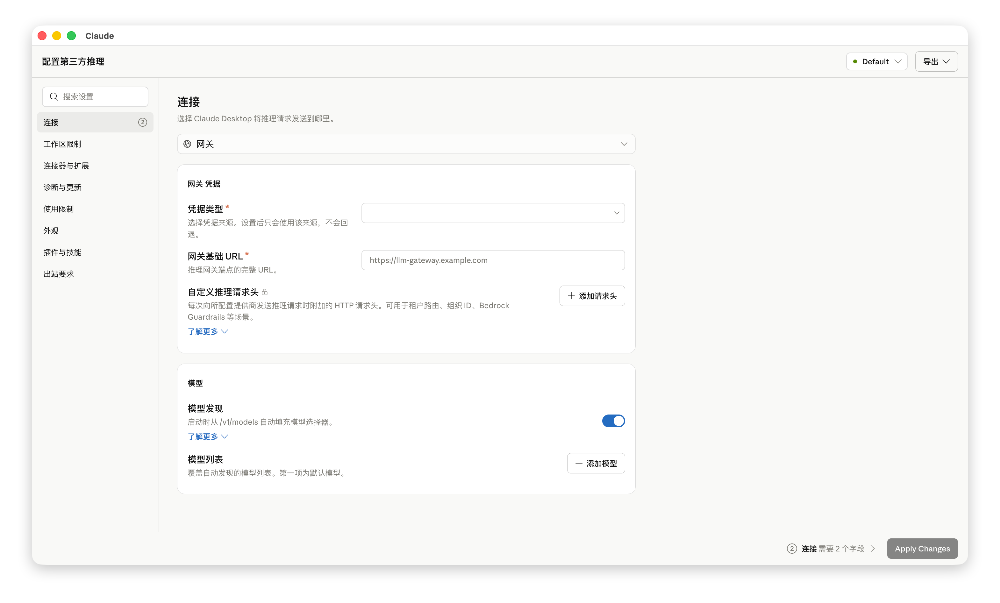
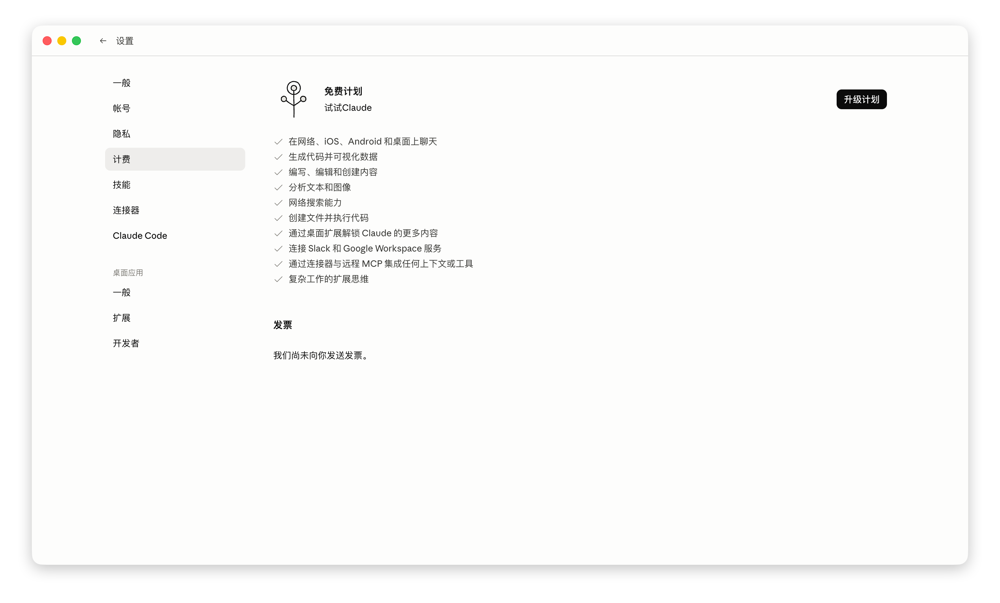

# Claude Desktop 中文补丁

一个用于 Claude Desktop 的本地中文界面补丁，支持简体中文、繁體中文（台灣）和繁體中文（香港）。

macOS 双击 `install-mac.command`；Windows 双击 `install-windows.bat` 后按 UAC 提示授权；Linux（deb 包安装）在终端运行 `./install-linux.sh`。脚本会给 Claude Desktop 添加中文语言选项并安装中文界面资源。

本项目支持官方账号和第三方 API，但不同安装模式覆盖的界面与 Cowork 兼容性不同，请先阅读下方的模式说明。第三方 API 配置可参考 [这篇教程](https://linux.do/t/topic/2032192)。

## 赞助商

<details open>
<summary>点击折叠</summary>
<table width="100%">
<tr>
<td width="250" align="center" valign="middle"><a href="https://tokenmetro.com"><picture><source media="(prefers-color-scheme: dark)" srcset="docs/images/tokenmetro-dark.png"></picture></a></td>
<td valign="middle"><strong>TokenMetro</strong> - 一家计费透明、自建号池的中转站。<br>
相对官方价格：GPT 1 折，Gemini 一次 5分，DeepSeek0.1折。<br>
明码标价，显示多少扣多少，不玩汇率魔术；自建号池，拒绝掺水。<br>
私信客服领取1r体验金，一键上车：<a href="https://tokenmetro.com">https://tokenmetro.com</a></td>
</tr>
<tr>
<td width="250" align="center" valign="middle"><a href="https://www.oxoapi.com"></a></td>
<td valign="middle"><strong>OXOAPI</strong> - 高质量国模自部署资源，AI 模型统一接口入口。热门国产模型 DeepSeek、Kimi、GLM 低至 4.5-6 折，海外模型低至 2.5 折；官网实时公开报价，价格自动刷新、通道状态透明可见；支持开具发票，企业采购更省心。注册即用：<a href="https://www.oxoapi.com">www.oxoapi.com</a>，完整价格表：<a href="https://www.oxoapi.com/pricing">www.oxoapi.com/pricing</a></td>
</tr>
</table>


</details>

<p align="center"><strong>遇到问题请及时反馈，欢迎扫码加入 claude desktop 交流。</strong></p>

<p align="center"></p>

## 界面截图

 

## 功能特点

- 一键安装 Claude Desktop 中文界面资源，支持 macOS、Windows 和 Linux（deb 包安装）。
- 支持三种中文变体：`zh-CN`（简体中文）、`zh-TW`（繁體中文（台灣））、`zh-HK`（繁體中文（香港））。
- 自动给 Claude 前端语言白名单加入当前选择的中文变体。
- macOS 和 Windows 只汉化第三方 API 模式的本地界面：Claude 官方账号登录页面已原生支持中文，这两个平台的脚本不再改动它。
- macOS 和 Windows 的本地斜杠菜单支持“英文命令名 + 中文说明”，兼容三种中文变体；命令 ID、搜索与点击行为保持不变。
- macOS 和 Linux 会合并当前 Claude 版本的英文语言文件与随包中文翻译；新版本新增但暂未翻译的字段保留英文，避免界面缺失文本。
- Windows 安装脚本会备份并修改当前 Claude Desktop 的资源文件，卸载时从备份恢复；不改写 `app.asar` 或 `Claude.exe` 完整性哈希，应用签名保持有效，Cowork 沙箱不受影响。
- Linux 安装脚本会备份并修改 deb 包安装目录下的资源文件和 `app.asar`，卸载时从备份恢复；Claude Desktop 升级后会识别版本变化并重新备份。
- macOS 安装前自动备份原始 `/Applications/Claude.app`。
- 自动写入 Claude 用户配置，将语言设置为所选中文变体。

## 适用环境

- macOS、Windows 或 Linux（deb 包安装）
- 已安装 Claude Desktop
- macOS 需要可用的 Python 3；脚本优先使用 `/usr/bin/python3`，不存在时从 `PATH` 查找 `python3`
- Windows 需要系统自带的 Windows PowerShell（`powershell.exe`）；批处理入口会自动请求管理员权限
- Linux 需要 Python 3 和 `sudo` 权限，且为官方 deb 包安装的 Claude Desktop（资源目录 `/usr/lib/claude-desktop/resources`，可用环境变量 `CLAUDE_RESOURCES` 覆盖）

## 使用方式

### macOS

1. 退出 Claude Desktop。
2. 下载或克隆本项目。
3. 双击 `install-mac.command`，选择操作：
   - `1` 安装中文补丁（第三方 API 模式）：安装中文资源、注册中文语言、汉化前端 bundle 与桌面壳层，并对应用做本机 ad-hoc 重签名。**不改写** `app.asar`；官方账号登录界面请直接使用 Claude 自带的语言设置。
   - `2` 恢复原样 / 卸载补丁。
   - `3` 自动更新设置：输入 `y` 禁止自动更新，输入 `n` 允许自动更新。
   - `4` CC Switch skills 同步：输入 `y` 同步，输入 `n` 删除之前的同步。
4. 选择安装后，脚本会先恢复已有旧备份以清理上一轮补丁；没有旧备份时会直接继续。
5. 选择语言：`1`=简体中文，`2`=繁體中文（台灣），`3`=繁體中文（香港）。
6. 按提示输入 Mac 登录密码（选项 `1`/`2`/`3`）。安装完成后 Claude 会自动重新打开。
7. 如果没有自动切换，打开左下角账号菜单，选择 `Language` -> 对应的中文选项。

CC Switch skills 同步会扫描 `~/.cc-switch/skills` 下包含 `SKILL.md` 的目录，只为 Claude Desktop 中不存在的同名 skill 创建软链接并更新 skills manifest。取消同步只删除由该目录同步出的软链接和对应记录，不删除 CC Switch 源目录。

### macOS 汉化后的自动更新

汉化会对应用做本机 ad-hoc 重签名。从 2026-08 版本起，重签时会显式写入 `identifier` 级别的 designated requirement（替代默认的 cdhash 级别），因此 Claude Desktop 的官方自动更新**下载后可以正常安装**，不会再卡在“下载完成但版本不变”。注意两点：

- 更新安装成功后，`/Applications/Claude.app` 会被官方英文版覆盖，重新运行本补丁即可恢复中文。
- 如果之前打过旧版补丁（默认 ad-hoc DR），需重新打一次补丁才会获得新签名行为。

### Windows

1. 退出 Claude Desktop。
2. 下载或克隆本项目。
3. 双击 `install-windows.bat`；脚本会复制安装文件到当前用户的临时目录，并弹出 UAC 管理员授权窗口。
4. 先选择操作：
   - `1` 安装中文补丁（第三方 API 模式，例如 DeepSeek）：安装中文资源、注册中文语言并汉化前端 bundle。**不改动** `app.asar` / `Claude.exe` 完整性哈希，因此应用签名与 Cowork 沙箱都不受影响。第三方模型需在网关或 CC Switch 中映射为 Claude/Anthropic 风格名称。
   - `2` 恢复原样 / 卸载补丁。
   - `3` 自动更新设置：输入 `y` 禁止自动更新，输入 `n` 允许自动更新。
   - `4` CC Switch skills 同步：输入 `y` 开启同步，输入 `n` 删除之前的同步。
5. 选择安装中文补丁时，脚本会先尝试从旧备份恢复来清理已有汉化；如果没有旧备份，会提示跳过并继续。
6. 选择语言：`1`=简体中文，`2`=繁體中文（台灣），`3`=繁體中文（香港）。
7. 脚本会备份被修改的文件、写入中文资源并重启 Claude Desktop。如果没有自动切换，打开左下角账号菜单，选择 `Language` -> 对应的中文选项。

商店版（Microsoft Store / MSIX）与官网安装包都受支持。安装器会自动识别 `Claude`、`AnthropicPBC.Claude` 等包名变化，也会跳过升级残留的旧 `app-*` 目录。

### Linux（deb 包安装）

1. 退出 Claude Desktop（脚本检测到正在运行时也会自动关闭）。
2. 下载或克隆本项目。
3. 在项目目录中打开终端，运行 `./install-linux.sh`，选择操作：
   - `1` 安装中文补丁：安装中文资源、注册中文语言，并修改 `app.asar`，包含在线页面 DOM 汉化和在线语言锁定。
   - `2` 恢复原样 / 卸载补丁。
4. 选择语言：`1`=简体中文，`2`=繁體中文（台灣），`3`=繁體中文（香港）。
5. 按提示输入 `sudo` 密码。完成后重新打开 Claude Desktop；如果没有自动切换，打开左下角账号菜单，选择 `Language` -> 对应的中文选项。

也可以跳过菜单直接调用：`./install-linux.sh install zh-CN`（可选 `zh-TW` / `zh-HK`）或 `./install-linux.sh uninstall`。

### Linux 升级后恢复

通过 apt 升级 Claude Desktop 会覆盖补丁，界面会变回英文。建议先更新本项目（克隆的用 `git pull`，下载压缩包的重新下载最新版本），再重新运行一次安装：

```bash
git pull
./install-linux.sh install zh-CN
```

脚本会识别 Claude Desktop 的版本变化，自动丢弃旧版本的备份并重新备份，不会把旧版 `app.asar` 装回去。若新版本改动了代码结构导致补丁没有生效，脚本会直接报错，请带上 Claude Desktop 版本号反馈。

## 文件说明

- `install-mac.command`：macOS 双击运行入口。
- `install-windows.bat`：Windows 安装 / 恢复菜单入口。
- `install-linux.sh`：Linux（deb 包）安装 / 恢复菜单入口。
- `scripts/install_windows.ps1`：Windows 汉化安装和卸载脚本。
- `scripts/install_linux.sh`：Linux（deb 包）汉化安装和卸载脚本；`install-linux.sh` 的菜单会调用它，也可直接带参数调用。
- `scripts/patch_linux_asar.py`：Linux 下复用 `patch_claude_zh_cn.py` 的 asar 补丁逻辑（伪造 macOS 目录布局 + 跳过 codesign/完整性），并在补丁后校验标记防止静默失败。
- `scripts/patch_claude_zh_cn.py`：真正执行补丁的 Python 脚本。
- `resources/manifest.json` / `manifest-zh-TW.json` / `manifest-zh-HK.json`：语言包信息。
- `resources/frontend-zh-CN.json` / `frontend-zh-TW.json` / `frontend-zh-HK.json`：Claude 前端界面中文翻译。
- `resources/frontend-hardcoded-zh-CN.json` / `frontend-hardcoded-zh-TW.json` / `frontend-hardcoded-zh-HK.json`：未走 i18n key 的前端硬编码文本映射，也用于在线账号页面的 DOM 翻译表。
- `resources/desktop-zh-CN.json` / `desktop-zh-TW.json` / `desktop-zh-HK.json`：Claude 桌面壳层中文翻译。
- `resources/Localizable.strings` / `Localizable-zh-TW.strings` / `Localizable-zh-HK.strings`：macOS 原生菜单中文资源。
- `resources/statsig-zh-CN.json` / `statsig-zh-TW.json` / `statsig-zh-HK.json`：statsig i18n 兜底资源。
- `resources/release.json`：安装入口用于检查 GitHub Releases 是否有新版的版本信息。

## 斜杠菜单双语说明

macOS / Windows 安装时，会尝试给本地 `SlashCommandMenuPopupBody` 中的已知内置命令追加中文说明，例如 `model  选择模型`、`permissions  权限模式`。原英文名称与搜索高亮保留，点击后仍执行原命令；自定义技能、第三方插件命令、连接器和未知命令不强行翻译。

- `resources/slash-command-glosses.json`：简体、繁体台湾、繁体香港的说明词表。
- `resources/slash-command-menu-patch.json`：两平台共用的组件匹配规则、唯一锚点和显示层补丁。匹配局部变量而不是固定 bundle 文件名。
- 重复安装不重复追加；直接切换语言时只更新说明词表。Windows 在写入前沿用现有原文件备份机制，macOS 沿用整包备份和重签流程。
- 若组件缺失、锚点不唯一或已有补丁形态不符，会输出 `WARNING` 并保持该菜单文件不变，其他汉化步骤继续。应用升级后可能需要更新匹配规则，语法匹配不代表兼容所有未来版本。
- 此功能不注入在线账号页面，也未接入 Linux 的独立安装脚本。

## 开发与回归测试

测试只使用合成菜单和临时目录，不启动或修改已安装的 Claude，不需要管理员权限。运行需要 Python 3.10+、Node.js，以及用于检查 Windows 逻辑的 PowerShell 5.1 或 PowerShell 7：

```bash
python -I -m unittest discover -s tests -v
```

```bash
powershell -NoProfile -ExecutionPolicy Bypass -File tests/Test-StructuralReplacements.ps1
```

```bash
powershell -NoProfile -ExecutionPolicy Bypass -File tests/Test-SlashCommandMenu.ps1
```

```bash
powershell -NoProfile -ExecutionPolicy Bypass -File tests/Test-WindowsTrayIcons.ps1
```

托盘图标测试在 Windows 临时目录中验证明暗两套资源、首次备份、重复安装、卸载还原、失败回滚，以及各尺寸图标的橙底白色像素；不会修改真实应用或任务栏。

PowerShell 7 环境可将 `powershell` 替换为 `pwsh`。测试覆盖高风险词跳过、三地 i18n、Windows 真实 C# 快速路径与备用路径、菜单点击/高亮、语言切换、幂等、备份顺序和不兼容组件的安全跳过。合成测试不能替代完整客户端的视觉验收。

## macOS 脚本会做什么

- 安装时备份当前 `/Applications/Claude.app` 到同目录，名字类似：
  `Claude.backup-before-zh-CN-20260424-120000.app`
- 安装前会先尝试恢复已有旧备份，清理上一轮汉化；没有旧备份时跳过并继续安装。
- 恢复 / 卸载时选择同目录下最早的 `Claude.backup-before-zh-CN-*.app` 恢复为 `/Applications/Claude.app`，并删除其他备份。
- 复制 Claude.app 到临时目录并打补丁。
- 给前端语言白名单加入当前选择的中文变体。
- 汉化前端 bundle 中未走 i18n key 的硬编码文本，并修正中文语言显示名称。
- 不修改 `Contents/Resources/app.asar`：在线账号界面由 Claude 原生提供中文，本项目不再注入 DOM 翻译、语言锁定或模型选择器补丁，因此不需要同步 `ElectronAsarIntegrity`。
- 合并当前 Claude 版本的 `en-US.json` 和随包中文翻译：
  当前版本已有中文翻译的 key 会变中文，新版本新增但本包没有的 key 会保留英文，避免应用缺字段。
- 写入 `~/Library/Application Support/Claude/config.json`，设置 `"locale"` 为所选语言代码（`zh-CN`、`zh-TW` 或 `zh-HK`）。
- 对修改后的 Claude.app 及其内部 app/framework/原生二进制做一致的本机 ad-hoc 重签名，并清除 `com.apple.quarantine` 隔离属性。
- 重新启动 Claude。
- 可选菜单项 `5` 用 `y/n` 控制 Claude Desktop 自动更新：`y` 禁止自动更新，`n` 允许自动更新。若当前存在有效的 Claude-3p `configLibrary`，脚本会写入当前 applied 配置；否则写入 Claude Desktop enterprise policy。
- 可选菜单项 `6` 用 `y/n` 控制 CC Switch skills 同步：`y` 会把 `~/.cc-switch/skills` 中缺失的 skill 软链接到 Claude Desktop 的本地 skills 目录，并更新对应 `manifest.json`；`n` 只删除之前同步产生的 CC Switch 软链接和对应 manifest 记录。该操作不需要管理员权限，不会覆盖同名 skill。

## Windows 脚本会做什么

- 查找 Windows 版 Claude Desktop 安装目录。
- 安装前会先尝试从 `resources\.zh-cn-backups` 恢复旧备份，清理上一轮汉化；没有旧备份时跳过并继续安装。
- 复制本仓库现有中文资源，不使用其他语言包项目里的 JSON：
  - `resources/frontend-zh-CN.json` / `frontend-zh-TW.json` / `frontend-zh-HK.json` -> `ion-dist\i18n\` 对应语言代码 `.json`
  - `resources/desktop-zh-CN.json` / `desktop-zh-TW.json` / `desktop-zh-HK.json` -> `resources\` 对应语言代码 `.json`
  - `resources/statsig-zh-CN.json` / `statsig-zh-TW.json` / `statsig-zh-HK.json` -> `ion-dist\i18n\statsig\` 对应语言代码 `.json`
- 给前端语言白名单加入当前选择的中文变体。
- 汉化前端 bundle 中未走 i18n JSON 的硬编码界面文本，例如侧边栏入口、配置页标签和模型选择项。
- 不修改 `app.asar`：不改写其内容，也不改写 `Claude.exe` 内嵌完整性哈希，因此 `Claude.exe` 的 Authenticode 签名保持有效，Cowork 沙箱/工作区不受影响。
- 写入 Windows 用户配置，将语言设置为所选语言代码（`zh-CN`、`zh-TW` 或 `zh-HK`）。
- 可选菜单项 `3` 用 `y/n` 控制 Claude Desktop 自动更新：`y` 禁止自动更新，`n` 允许自动更新。若当前存在有效的 Claude-3p `configLibrary`，脚本会写入当前 applied 配置；否则写入 `HKCU\SOFTWARE\Policies\Claude` policy。
- 可选菜单项 `4` 用 `y/n` 控制 CC Switch skills 同步：`y` 会把 `%USERPROFILE%\.cc-switch\skills` 中缺失的 skill 以软链接加入 Claude Desktop 的本地 skills 目录，并把 `SKILL.md` frontmatter 里的 `name` 和 `description` 写入对应 `manifest.json`；`n` 只删除之前同步产生、且指向 CC Switch skills 目录内的软链接和对应 manifest 记录。脚本会从当前用户的 AppData 动态扫描 Claude-3p skills plugin，不写死 session UUID，不覆盖同名 skill，也不删除 CC Switch 源目录。
- 将 Windows 通知区域的托盘图标替换为橙色圆角底、白色星标，明暗主题保持一致，避免单色黑图标在深色任务栏上看不清。素材 `resources/claude-tray-windows.ico` 来自官方 Windows 包 Claude 3.1623.1.0 的 `assets/Square44x44Logo.targetsize-256.png`，含 16–256 像素共九档 32 位 DIB 图像，保留圆角透明边缘。仅替换已知的 `Tray-Win32.ico` / `Tray-Win32-Dark.ico`，沿用资源备份；卸载时还原原图标。不修改桌面快捷方式、任务栏固定项、EXE 或 ASAR 来实现此功能。
- 重启 Claude Desktop 后生效；运行中的应用会缓存托盘图像，仅覆盖文件不会立即刷新。

## Linux 脚本会做什么

- 查找 deb 包安装的 Claude Desktop 资源目录（默认 `/usr/lib/claude-desktop/resources`，可用环境变量 `CLAUDE_RESOURCES` 指定），并关闭该安装目录下正在运行的 Claude Desktop 进程。
- 读取 Claude Desktop 版本号，与上次备份时记录的版本（`.zh-orig-version`）比较；版本变化说明应用已升级，会丢弃旧版本备份，从升级后的新文件重新备份，避免用旧版 `app.asar` 覆盖新版本。
- 合并当前 Claude 版本的英文语言文件与随包中文翻译（当前版本已有中文翻译的 key 会变中文，新版本新增但本包没有的 key 保留英文），写入安装目录：
  - `resources/frontend-zh-CN.json` / `frontend-zh-TW.json` / `frontend-zh-HK.json` -> `ion-dist/i18n/` 对应语言代码 `.json`（以及 `.overrides.json`）
  - `resources/desktop-zh-CN.json` / `desktop-zh-TW.json` / `desktop-zh-HK.json` -> `resources/` 对应语言代码 `.json`
- 备份前端 bundle 为同目录的 `*.zh-orig`，然后给语言白名单加入当前选择的中文变体，并修正中文语言显示名称。
- 备份 `app.asar` 为 `app.asar.zh-orig`，每次都基于这份原始备份重新打补丁（可重复运行）：由 `scripts/patch_linux_asar.py` 复用 `patch_claude_zh_cn.py` 的逻辑，注入在线账号页面 DOM 翻译和语言锁定。Linux 版 Electron 不校验 `app.asar` 完整性，因此不需要 macOS 的重签名步骤。
- 打完补丁后校验 `app.asar` 中确实写入了补丁标记；如果 Claude 新版本改动了代码结构导致补丁没有生效，会报错退出，而不是静默跳过。
- 写入 `~/.config/Claude/config.json`，设置 `"locale"` 为所选语言代码（`zh-CN`、`zh-TW` 或 `zh-HK`）。
- 恢复 / 卸载时删除三种中文资源，用 `*.zh-orig` 备份还原前端 bundle 和 `app.asar`，清除版本记录，并把用户语言设置恢复为 `en-US`。

## 卸载 / 恢复

执行对应平台的安装入口并选择「恢复原样 / 卸载补丁」（macOS 和 Windows 为 `2`，Linux 为 `2`）。macOS 会恢复 `/Applications` 下最早的 `Claude.backup-before-zh-CN-*.app` 并删除其他补丁备份；Windows 会恢复备份文件、删除三种中文资源并把用户语言设置恢复为 `en-US`；Linux 会用备份还原前端 bundle 和 `app.asar`、删除三种中文资源并把用户语言设置恢复为 `en-US`（也可直接运行 `./install-linux.sh uninstall`）。

## 注意事项

- Claude Desktop 更新可能覆盖补丁。建议先恢复补丁，再更新 Claude Desktop，最后使用本项目最新版本重新安装。
- Linux 仅支持官方 deb 包安装（`/usr/lib/claude-desktop`）；AppImage、Flatpak、Snap 等安装方式的目录结构不同，暂不支持。Linux 脚本不做重签名，暂不包含前端 bundle 硬编码文本汉化、主进程菜单汉化和第三方网关模型名校验绕过。
- macOS 和 Windows 不再改写 `app.asar`，因此不涉及在线账号页面的 DOM 汉化；这部分已由 Claude 官方原生提供中文。Linux 脚本仍保留原有的 `app.asar` 补丁行为。

## Star History

<a href="https://www.star-history.com/?type=date&repos=javaht%2Fclaude-desktop-zh-cn">
 <picture>
   <source media="(prefers-color-scheme: dark)" srcset="https://api.star-history.com/chart?repos=javaht/claude-desktop-zh-cn&type=date&theme=dark&legend=top-left&sealed_token=nC4gK9npC6J22iJX6ySvcDb9bLLzJi92ny-y20orz28GWvjXDHLZDuo0vqfJ7odAe7h_TdxZVOFEAXl290Auc3da0o8fLzdK6F6vAbUoM1d3_L0A7tklYQ" />
   <source media="(prefers-color-scheme: light)" srcset="https://api.star-history.com/chart?repos=javaht/claude-desktop-zh-cn&type=date&legend=top-left&sealed_token=nC4gK9npC6J22iJX6ySvcDb9bLLzJi92ny-y20orz28GWvjXDHLZDuo0vqfJ7odAe7h_TdxZVOFEAXl290Auc3da0o8fLzdK6F6vAbUoM1d3_L0A7tklYQ" />
   
 </picture>
</a>

## 免责声明

本项目为非官方中文补丁，会修改本机 Claude Desktop 的资源文件及相关本地配置，不会修改 Claude 服务端账号数据。Claude Desktop 更新后资源结构可能变化；若补丁失败，请先恢复原版应用并更新本项目，不要在安装未完成的状态下反复运行脚本。
